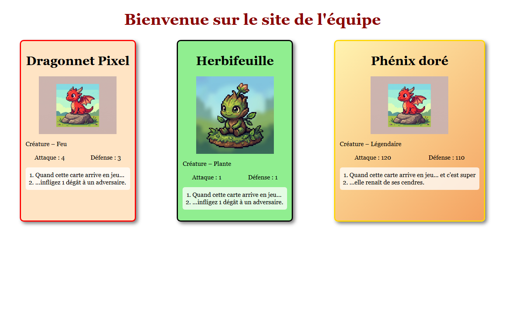
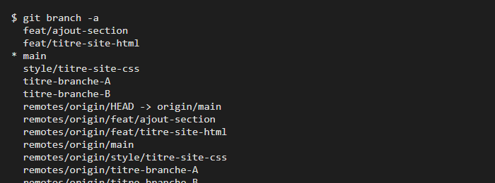
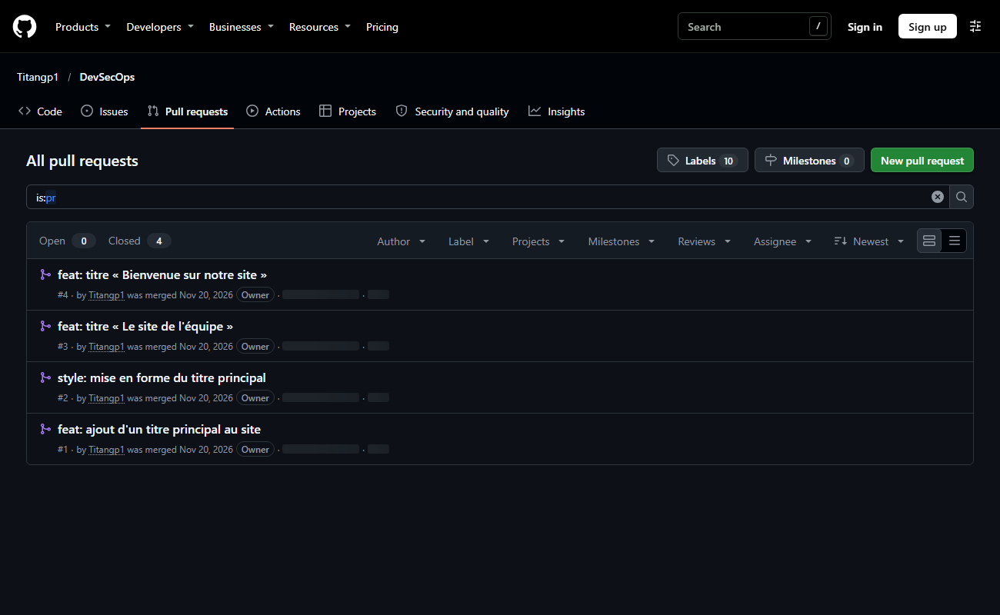
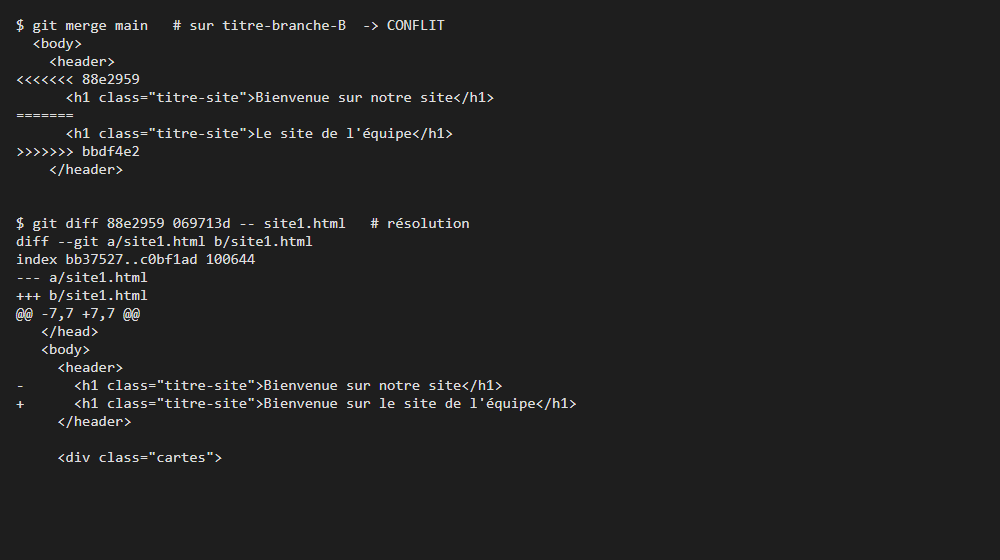
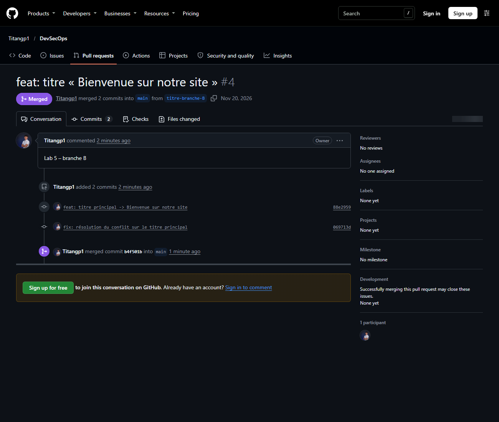
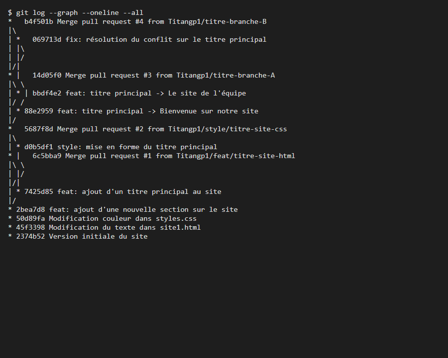

# DevSecOps – Site de cartes de créatures

Site HTML/CSS/JavaScript versionné avec Git : labs Git (Labs 1 à 5) puis exercices API (Exercices 1 et 2).

**Site en ligne :** https://titangp1.github.io/DevSecOps/

## Structure du projet

| Fichier | Rôle |
|---|---|
| `index.html` | Page d'accueil : les cartes de créatures + bouton « Voir les Cat Facts » |
| `catfacts.html` | Page des exercices API (Cat Facts et PokéAPI) |
| `script.js` | Code JavaScript des appels API (séparé du HTML) |
| `styles.css` | Styles des deux pages |
| `screenshots/` | Captures d'écran des labs Git |

> `site1.html` (cité dans les labs ci-dessous) a été renommé en `index.html` pour être servi par défaut par GitHub Pages.

## Lab 1 – Versionner son code

Création du dépôt (`git init`), ajout des fichiers (`git add`) puis premier commit **« Version initiale du site »**.
`git status` affiche ensuite *nothing to commit, working tree clean* : aucune modification non enregistrée.

## Lab 2 – Observer les changements avant de les enregistrer

Deux modifications, deux commits distincts (vérifiées avec `git status` et `git diff`) :
- `Modification du texte dans site1.html`
- `Modification couleur dans styles.css`

Un commit par changement permet de comprendre, relire ou annuler chaque modification séparément.

## Lab 3 – Travailler sur une branche

Branche `feat/ajout-section` (nommage *Conventional Commits*) → commit `feat: ajout d'une nouvelle section sur le site` → fusion dans `main`.
L'amélioration n'apparaît dans `main` qu'au moment de la fusion.

## Lab 4 – Partager le travail avec un camarade

Une branche par personne, chacune sur un fichier différent :
- `feat/titre-site-html` : ajout d'un titre principal dans `site1.html` (PR #1)
- `style/titre-site-css` : mise en forme de ce titre dans `styles.css` (PR #2)

Les deux pull requests ont été fusionnées sans conflit dans `main`.

## Lab 5 – Résoudre un conflit

1. `titre-branche-A` → titre « Le site de l'équipe » (PR #3)
2. `titre-branche-B` → titre « Bienvenue sur notre site » (PR #4)
3. Avant la fusion de A, la PR #4 était *mergeable* ; après la fusion de A, GitHub l'indique **en conflit**.
4. Résolution : on garde un mix des deux titres, **« Bienvenue sur le site de l'équipe »**, et on supprime les marqueurs de conflit.

## Historique final

## Exercice 1 – Cat Facts API

Sur `catfacts.html`, le bouton **Cat Facts** appelle `https://catfact.ninja/fact` avec `fetch` et affiche le fait reçu sous le bouton (message « Chargement... » pendant l'appel, message d'erreur en cas d'échec).

Branche : `feat/cat-facts`, puis `feat/page-cat-facts` (page dédiée + bouton de redirection depuis l'accueil).

## Exercice 2 – PokéAPI

Sur la même page, on saisit le nom (en anglais) ou le numéro d'un Pokémon, puis le bouton **Chercher le Pokémon** appelle `https://pokeapi.co/api/v2/pokemon/<nom>` et affiche :
- son sprite (image fournie par l'API),
- son numéro, son nom et son type,
- ses statistiques (hp, attack, defense, special-attack, special-defense, speed).

Un nom inconnu affiche « Pokémon introuvable ». L'affichage est construit avec `textContent` / `createElement` (pas d'`innerHTML`) pour ne pas injecter de HTML venant de l'API.

Branche : `feat/pokeapi`.

## Lancer le site en local

Ouvrir `index.html` dans un navigateur, ou publier via GitHub Pages (branche `main`, dossier racine). Chaque push sur `main` met le site en ligne à jour en une à deux minutes.
